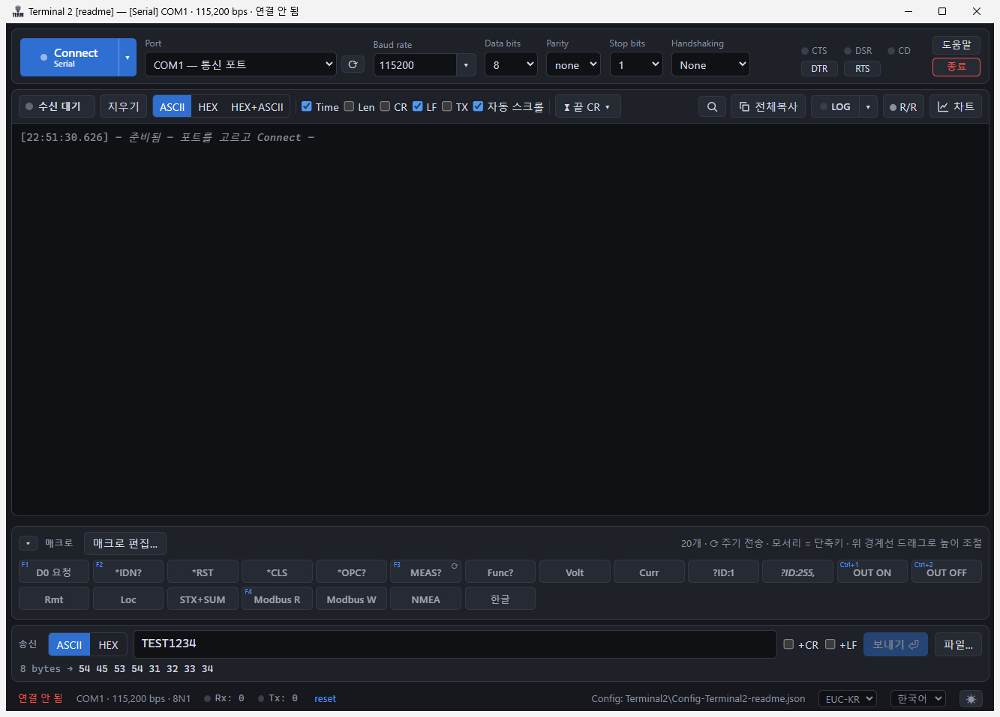
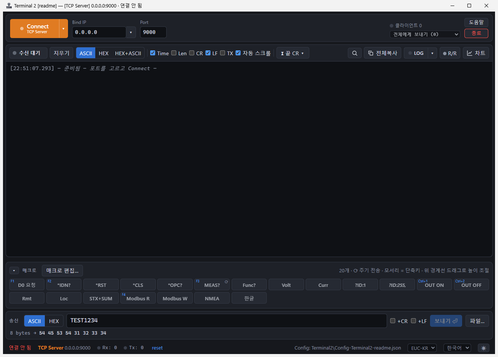

# Terminal 2

Windows용 시리얼 / TCP / UDP 터미널입니다. 예전 Win32 프로그램 "Terminal 1.9b"를 Electron + React로 다시 만들었고, 장비 통신 시험과 프로토콜 디버깅에 쓰는 기능(매크로, 자동 응답, 체크섬, 실시간 차트, 파일 로그)을 담았습니다.



## 주요 기능

**연결**
- Serial(COM), TCP Client, TCP Server, UDP. Connect 버튼 오른쪽 ▾에서 방식을 고릅니다.
- LOOPBACK 가상 포트: 장비 없이 보낸 데이터가 그대로 수신되어 매크로와 자동 응답을 시험할 수 있습니다.
- TCP Server: 여러 클라이언트를 받고, 전체 또는 특정 클라이언트에게 보냅니다. 수신 줄 앞에 `[IP:port]`가 붙습니다.
- UDP: 로컬/원격 주소와 포트, Broadcast.
- 최근 연결한 주소를 방식별로 20개까지 기억합니다.

**수신과 송신**
- 표시 방식: ASCII / HEX / HEX+ASCII. 시간과 길이 표시, 찾기, 복사.
- 패킷 구분: 시간 간격 / 끝 문자(LF·CR·ETX) / 길이 바이트.
- 매크로: 단축키, 주기 전송, 체크섬(SUM8, XOR8, LRC8, CRC16 Modbus/CCITT/XMODEM, CRC32).
- R/R(Request/Response) 자동 응답: 와일드카드, 정규식, 체크섬 검증. 응답에 요청 바이트를 `R[n]`으로 넣을 수 있습니다.
- 파일 전송: 줄 단위 / 파일 전체 / N바이트씩, 간격(ms) 지정.
- 한글 인코딩: EUC-KR / UTF-8.

**기록과 분석**
- 파일 로그(`● LOG`): 연결할 때마다 새 파일에 송수신을 계속 기록합니다. 10MB마다 다음 파일로 넘어가고, 보관 기간이 지난 파일은 자동으로 지웁니다.
- 실시간 차트: 수신 패킷에서 값을 뽑아 그래프로 보여 줍니다. 경보 범위를 정할 수 있고 PNG로 저장됩니다.

**여러 창 함께 쓰기**
- 타이틀바에 연결 방식과 주소가 표시되고, Connect 버튼 색이 방식마다 다릅니다(Client 청록, Server 주황, UDP 보라).
- 같은 exe를 여러 번 실행하면 두 번째 창부터 `#2`가 붙고 설정을 따로 저장합니다.
- 프로필: `Terminal2.exe --profile=server`처럼 실행하면 늘 같은 설정으로 뜹니다. 앱에서 바탕화면 바로가기를 만들 수 있습니다.



## 실행

빌드된 폴더 `app/dist/Terminal2/`를 통째로 복사해서 `Terminal2.exe`를 실행합니다. 설치 과정은 없습니다.

실행 폴더에 생기는 파일:

| 파일 / 폴더 | 내용 |
|---|---|
| `configTerminal.json` | 모든 설정, 매크로, R/R 규칙 (바뀌면 바로 저장) |
| `configTerminal-2.json`, `configTerminal-<프로필>.json` | 두 번째로 실행한 창, 프로필별 설정 |
| `Log\Serial\`, `Log\TcpClient\`, `Log\TcpServer\`, `Log\Udp\` | 파일 로그 (`날짜_시각_대상.log`) |
| `backup\` | 매크로/R/R/차트 목록을 불러오기 직전에 자동 보관한 사본 |

실행 폴더에 쓸 권한이 없으면 설정은 사용자 폴더(`%APPDATA%\terminal2`)에 저장되고, 그 위치가 상태바에 표시됩니다.

## 빌드

필요한 것: Windows 10/11 x64, Node.js 22 이상

```bash
cd app
npm install
npm run dev        # 개발 실행
npm run typecheck  # 타입 검사
npm run test       # 단위 테스트 (vitest)
npm run dist       # app/dist/Terminal2/ 폴더 빌드 (기존 configTerminal*.json은 유지)
```

VS Code 터미널에서 실행이 안 되면 환경 변수 `ELECTRON_RUN_AS_NODE`를 지운 뒤 다시 실행합니다.

## 구조

```
app/src/
├─ main/        Electron main: 창, 설정 파일, 파일 로그, 프로필
│  └─ transport/  연결 방식 (serial, tcpClient, tcpServer, udp)과 이를 관리하는 manager
├─ preload/     renderer에 window.api만 노출 (contextBridge)
├─ renderer/    React UI
│  └─ src/lib/store/  Zustand 상태 (연결, 매크로, 화면, 파일 전송, 설정 저장)
└─ shared/      main과 renderer 공용 (IPC 채널 이름, 연결 타입, 패킷 구분 Framer)
```

- 연결 방식은 모두 같은 `Transport` 인터페이스(open / close / write / setFrame)로 다룹니다. 수신 데이터는 16ms 단위로 묶어서 화면에 전달합니다.
- IPC 채널 이름은 `app/src/shared/ipc.ts` 한 곳에서 정의합니다.

## 기술 스택

Electron 44, React 19, TypeScript 7, Vite 7 (electron-vite), Zustand 5, serialport 13, ECharts 6, electron-builder, vitest
